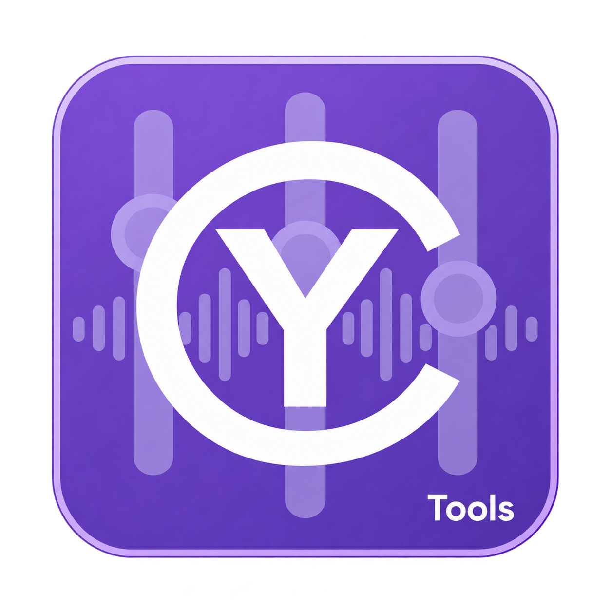
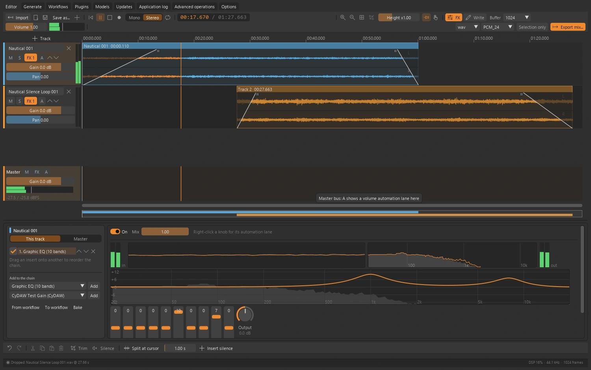
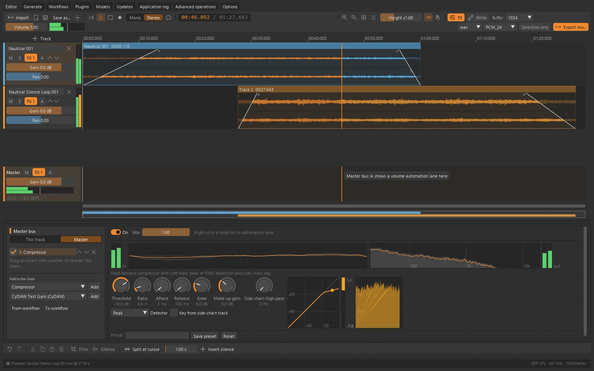
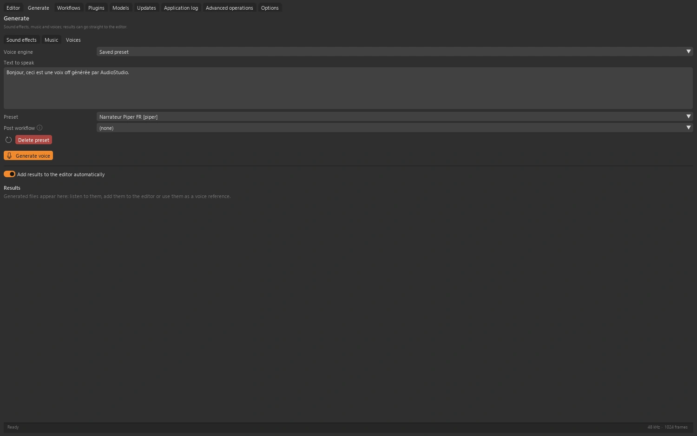

<table width="100%">
  <tr>
    <td width="300" align="left" valign="top">
      <a href="https://mrmybal.github.io/CyTools_AudioStudio/?lang=fr">Site web</a><br>
      <a href="https://mrmybal.github.io/CyTools_AudioStudio/Documentation.html#/fr/overview">Documentation</a><br>
      <a href="https://github.com/MrMybal/CyTools_AudioStudio">GitHub</a><br><br>
      <sub>README</sub><br>
      <a href="README.md">English</a> · <a href="README.fr.md">Français</a>
    </td>
    <td width="400" align="center" valign="middle">
      <a href="https://mrmybal.github.io/CyTools_AudioStudio/?lang=fr"></a>
    </td>
    <td width="300" align="right" valign="top">
      <p><sub>Licence de l’application</sub><br><a href="LICENSE"><strong>GPL-3.0-only</strong></a></p>
      <p><sub>Version de l’application</sub><br><a href="VERSION.fr.md"><strong>0.1.5</strong></a><br><strong>EXPÉRIMENTAL</strong></p>
      <p><a href="https://github.com/MrMybal/CyTools_AudioStudio/releases/download/v0.1.5/CyTools_AudioStudio-0.1.5-windows-x64.zip"><strong>Télécharger</strong></a><br><sub>Windows x64 · portable</sub></p>
    </td>
  </tr>
</table>

<h1 align="center">CyTools AudioStudio</h1>


Un espace multipiste pour monter l’audio, travailler les effets, réutiliser des chaînes de traitement et ajouter des modèles de son, de musique et de voix. Pour les sound designers, les créateurs de voix et les monteurs qui veulent associer outils audio et génération locale.

> **EXPÉRIMENTAL · 0.1.5**
>
> Version Windows publiée pour évaluation ; certains parcours des moteurs restent à valider. Consultez les [notes de version et limites connues](VERSION.fr.md).

[](website/assets/showcase/editor.webp)

*Éditeur multipiste · clips audio et égaliseur graphique de piste.*


## L’application

### Montage multipiste

Déplacez les clips entre pistes, ajustez leurs bords et leurs fondus, puis enregistrez depuis le microphone. Les sessions sont conservées dans des dossiers, avec annulation et rétablissement pendant le montage.

### Effets et analyse

Les effets natifs proposent des contrôles visuels utiles : courbes d’égalisation et de dynamique, vumètres, oscilloscopes et spectres. Travaillez sur une piste ou le master et écoutez le résultat pendant la lecture.

[](website/assets/showcase/compressor.webp)

*Compresseur du master · courbe de transfert, réduction de gain et vumètres.*


### Modèles et traitements

Créez des effets sonores, de la musique ou de la parole avec un moteur compatible installé. L’installation des modèles reste distincte de l’éditeur. Enregistrez des workflows pour les sélections, pistes, fichiers ou lots.

[](website/assets/showcase/generation.webp)

*Espace de génération · choix de la famille et réglages du moteur.*


## Fonctionnalités

- **Montage :** clips multipistes, bords et fondus, édition de sélection, enregistrement, déplacements entre pistes, sessions et annulation/rétablissement.
- **Traitement :** dynamique, égalisation, filtres, réverbération, délai, modulation, saturation, restauration et analyseurs natifs ; chaînes piste/master, vumètres et automation.
- **Plugins et workflows :** effets VST3 compatibles, chaînes enregistrées, édition de sessions sans interface et rendu par lots. Les fins de réverbération et de délai sont conservées.
- **Génération :** effets procéduraux et parcours facultatifs AudioLDM, ACE-Step, Piper, Qwen3-TTS et Fish Speech. Paramètres et disponibilité dépendent du moteur installé.
- **Mastering et presets vocaux :** cibles de sonie, mastering sur référence, réglages de voix réutilisables et annotations d’interprétation compatibles.

**Application et automatisation :** l’anglais est la langue par défaut ; le français se choisit dans Options. Enregistrez/chargez les configurations, consultez les journaux copiables et utilisez les opérations déclarées par CLI ou MCP. Le [manuel](https://mrmybal.github.io/CyTools_AudioStudio/Documentation.html#/fr/overview) décrit les paramètres et contrats de sortie réels.

---

## Installation

La version applicative publiée est pour **Windows x64**. Le ZIP portable inclut son Python privé et les dépendances de base de l’interface et des médias. Les modèles et moteurs lourds facultatifs se téléchargent séparément.

1. [Téléchargez CyTools AudioStudio 0.1.5](https://github.com/MrMybal/CyTools_AudioStudio/releases/download/v0.1.5/CyTools_AudioStudio-0.1.5-windows-x64.zip).
2. Extrayez le ZIP complet dans un dossier accessible en écriture. Gardez `app/` et `runtime/` à côté du lanceur.
3. Lancez **CyTools_AudioStudio.exe**. Utilisez l’espace d’installation/modèles pour les composants nécessaires ; consultez leurs licences et conditions d’accès avant le téléchargement.

Aucun Python système n’est nécessaire pour ouvrir le portable. L’installation depuis les sources et certains moteurs facultatifs nécessitent des outils supplémentaires comme Git. Conservez le dossier complet ; l’exécutable seul ou le ZIP de mise à jour `app` ne constitue pas une installation complète.

Windows x64 est testé ; Linux n’est pas validé. Le montage, le DSP natif, les VST3 et Piper utilisent le CPU. Les autres moteurs de génération ont leurs propres exigences CUDA et mémoire. Les moteurs et poids sont téléchargés séparément. ASIO et VST2 ne sont pas fournis.

### Mises à jour et données

Pour une installation compatible existante, utilisez Mises à jour et le paquet applicatif correspondant. Préservez `data/`, les moteurs et les modèles. Ne forcez pas une mise à jour destinée à un autre ABI. Si le runtime requis change, installez le portable complet dans un dossier séparé et suivez la migration.

## Sources, compilation et bibliothèques nécessaires

<details>
<summary>Installation des sources Windows et outils de compilation facultatifs</summary>


Utilisez Python **3.11** pour l’environnement de base depuis les sources. Git sert au clonage et aux dépendances Git épinglées. Compiler le lanceur nécessite les Build Tools MSVC x64 et une invite développeur.

```powershell
git clone https://github.com/MrMybal/CyTools_AudioStudio.git
cd CyTools_AudioStudio
py -3.11 -m venv runtime\python
runtime\python\Scripts\python.exe -m pip install "cytools-core[mcp] @ git+https://github.com/MrMybal/CyToolsCore.git@a8d200f2d0baaade1633e0683663b4506c595f74"
runtime\python\Scripts\python.exe -m pip install -r app\requirements.txt
runtime\python\Scripts\python.exe app\scripts\build_plugin_host.py
powershell -File app\build_launcher.ps1
.\CyTools_AudioStudio.exe
```

Les dépendances de base exactes sont dans [app/requirements.txt](app/requirements.txt). Les moteurs utilisent leurs propres environnements et catalogues ; installer la base ne les installe pas. Consultez le [guide développeur](app/README.md) pour la compilation détaillée et les composants facultatifs.

Le worker natif de plugins nécessite aussi CMake et un compilateur C++20 ; NASM est facultatif. Sa licence distincte et ses dépendances sont décrites dans [app/native/README.md](app/native/README.md).

</details>

---

## Licence

**CyTools AudioStudio utilise la licence [GPL-3.0-only](LICENSE).** CyToolsCore, CyUI et CyDoc restent des composants MIT ; leurs licences ne changent pas celle de l’application. Moteurs, plugins et poids conservent leurs propres conditions.

### Principaux composants et bibliothèques tierces

| Bibliothèque · sources | Licence · texte | Utilisation / périmètre |
| --- | --- | --- |
| [CyToolsCore 0.10.1](https://github.com/MrMybal/CyToolsCore) | [MIT](LICENCES/CyToolsCore-MIT.txt) | SDK/runtime : jobs, sessions, ressources, CLI et MCP. |
| [CyUI 1.2.0](https://github.com/MrMybal/CyUI) | [MIT](LICENCES/CyUI-MIT.txt) | Modules Python d’interface sélectionnés et inclus. |
| [CyDoc 0.1.0](https://github.com/MrMybal/CyDoc) | [MIT](LICENCES/CyDoc-MIT.txt) | Lecteur local inclus ; Node/npm servent uniquement à la rédaction/génération. |
| [Dear ImGui / imgui-bundle](https://github.com/pthom/imgui_bundle) | [MIT + notices des composants](https://github.com/pthom/imgui_bundle/blob/main/LICENSE) | Rendu de l’interface et composants natifs inclus. |
| [CPython 3.11](https://www.python.org/) | [PSF + notices des composants](https://docs.python.org/3.11/license.html) | Runtime privé inclus dans l’archive Windows portable. |
| [pedalboard](https://github.com/spotify/pedalboard) | [GPL-3.0](app/licenses.json) | DSP natif de base et hôte VST3 ; conserve ses notices JUCE. |
| [Isolated native plugin host / JUCE 8](app/native/README.md) | [AGPL-3.0; JUCE also offers commercial terms](app/native/licenses/JUCE-LICENSE.md) | Worker exécutable distinct de l’application Python GPL. Compilation CMake/C++20 ; les dépendances CLAP/ysfx gardent leurs notices. |
| [NumPy / SciPy / PyAV / sounddevice](app/requirements.txt) | [BSD / MIT + native notices des composants](LICENCES/ThirdParty-Notices.txt) | Traitement, décodage, lecture et enregistrement de base. |
| [pyloudnorm / Matchering](app/requirements.txt) | [MIT / GPL-3.0](LICENCES/ThirdParty-Notices.txt) | Mesure de sonie et mastering sur référence. |
| [Piper / ONNX Runtime](app/requirements-engine-piper.txt) | [GPL-3.0-or-later / MIT](https://github.com/OHF-Voice/piper1-gpl/blob/main/COPYING) | Moteur vocal CPU facultatif ; les poids des voix gardent leurs licences. |
| [PyTorch and generation engines](app/engines.json) | [Selon le composant; conditions des modèles distinctes](app/licenses.json) | Moteurs facultatifs AudioLDM, ACE-Step, Qwen3-TTS et Fish Speech. Les poids Fish Speech ont des restrictions de recherche. |

Ce tableau indexe les principaux composants sans remplacer leurs notices transitives complètes. Conservez [LICENCES/](LICENCES/), [app/licenses.json](app/licenses.json), les licences des paquets installés et celles de chaque moteur/modèle facultatif. Les bibliothèques CUDA installées conservent aussi les conditions NVIDIA.

L’application Python est GPL-3.0-only. Le worker natif isolé est un exécutable AGPL-3.0 distinct ; conservez sa [licence JUCE](app/native/licenses/JUCE-LICENSE.md) et ses notices. Piper 1.8.0 est GPL-3.0-or-later ; ONNX Runtime et chaque voix ont leurs propres conditions.

## Références et liens

- [Documentation](https://mrmybal.github.io/CyTools_AudioStudio/Documentation.html#/fr/overview)
- [Site web](https://mrmybal.github.io/CyTools_AudioStudio/?lang=fr)
- [Dépôt des sources](https://github.com/MrMybal/CyTools_AudioStudio) · [Releases et sommes de contrôle](https://github.com/MrMybal/CyTools_AudioStudio/releases)
- [Suivi des problèmes](https://github.com/MrMybal/CyTools_AudioStudio/issues) · [Notes de version](VERSION.fr.md)
- [Guide développeur](app/README.md)

<details>
<summary><strong>AI Usage</strong></summary>

- [Commencer ici : guide IA du projet](app/AGENTS.md) — règles du produit et fichiers importants.
- [Opérations et intégration IA](app/Documentation/DocAI.md) — contrats réels et utilisation en tâches.
- [Compiler cette application](app/README.md) — installation des sources et commandes propres au produit.

</details>
