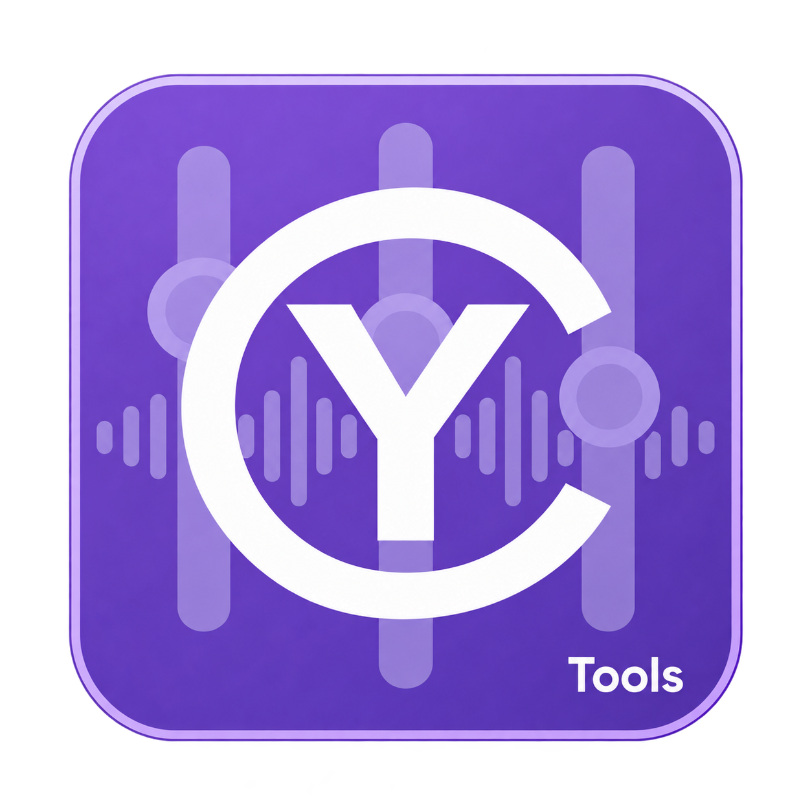

# CyTools AudioStudio

<p align="center">
  
</p>

A standalone audio studio for Windows (desktop application, command line and MCP server on one
runtime), built on the [CyToolsCore](https://github.com/MrMybal/CyToolsCore) SDK. French user
guide: [LISEZ-MOI.md](LISEZ-MOI.md). Developer guide: [app/README.md](app/README.md).

## What it does

- **Multitrack editor** in the spirit of GoldWave / Audacity: waveforms per channel, several clips
  per track that you can move (also onto another track, which then plays them through its own
  effects), trim (non-destructively), fade from their corners, reverse from their right-click menu, selection editing (cut, copy,
  paste, delete, trim, silence, split into two clips), undo / redo, recording from the microphone,
  playback through the default output, sessions saved as folders.
- **Interface** drawn with CyUI, the interface library of the Cy* applications (CyDAW 2, Shaderixel,
  CyEngineHub), ported to Python in `app/gui/cyui`: five themes (mid grey, light grey, amber night,
  violet, navy) and two densities chosen in Options, Segoe UI fonts with icon buttons, tooltips that
  name each action and its shortcut, property tables in the forms, a status bar (last message,
  running jobs with their progress and a cancel button, audio engine state) and notifications.
- **Insert chains per track and on the master bus** with 106 native effects (92 of them real-time)
  and VST3 plugins, each with its own interface: input / output meters, a live scope and a live
  spectrometer of the audio entering and leaving the effect, transfer
  curve and gain-reduction history for the dynamics, draggable bands over the live spectrum for the
  parametric EQ, crossovers for the multiband processors, decay envelope for the reverbs, echo taps
  for the delays, LFO views, goniometer, spectrum analyser, LUFS loudness meter, 16-step pattern
  editor, pitch-correction gauge. Everything is heard while playing.
- **Automation lanes** for volume, pan, mute and any parameter of any insert (native effect or
  VST3), drawn over the track, edited with the mouse, or recorded live while playing.
- **Effects belong to a track or to the master bus**, never to the whole editor: clicking a track
  (or the master lane) shows its chain in the FX panel; add, remove, bypass, drag to reorder, bake it
  into the clip, or send it to the Workflows tab.
- **Drag and drop**: an audio file dropped on a track becomes a clip of that track, at the time under
  the mouse when that place is free and after its last clip otherwise; dropped below the tracks it
  becomes a new track; an empty track (**+ Track** button) simply takes it and keeps its inserts. A
  session folder opens it, a workflow file loads it, an impulse response dropped on a convolution
  effect is used by it. Clips move between tracks by dragging their title bar up or down (or with
  *Move to track* in their right-click menu); inserts and chain items are reordered by dragging them.
- **Search by text** in every effect and plugin picker (accent and case insensitive, name, category
  and description; Enter picks the first match).
- **Effects**: compressors (feed-forward, vintage opto / VCA / FET / vari-mu, multiband, dynamic EQ,
  de-esser, transient shaper, look-ahead maximizer, gate, expander), equalisers and filters
  (parametric, graphic, tilt, shelves, notch, ladder, auto-wah, formants, hum remover), reverbs
  (JUCE, impulse-response hall / plate / room / chamber / cathedral / spring, convolution, shimmer,
  gated), delays (tape, tempo-synced, ping-pong, multi-tap, dual, reverse), modulation (chorus,
  ensemble, flanger, phaser, vibrato, tremolo, auto-pan, rotary speaker, ring modulator, frequency
  shifter, doubler, resonator), saturation (tape, tube, overdrive, fuzz, wave folder, multiband,
  guitar amp with cabinets, exciter, bit crusher, cassette, vinyl, telephone), vocal tools (vocoder,
  real-time pitch shifter, pitch correction, harmoniser), stereo tools, restoration (real-time
  spectral noise reduction, de-clicker), analysers and utilities.
- **Workflows**: chains of effects, VST3 plugins and models saved as JSON, applied to a selection,
  a track, a file or a folder, with **tail rendering** so reverb and delay tails are never cut.
- **Generation** with several models per family, selectable in the interface: sound effects
  (procedural synthesiser, AudioLDM), music (ACE-Step 1.5: songs, remix, repaint, lyrics), voices
  (Piper, Qwen3-TTS, Fish Speech S2 Pro) with voice cloning from a file or the microphone, voice
  presets that regenerate the same voice, an optional text assistant for TTS annotations, Whisper
  transcription.
- **Mastering**: loudness normalisation with a true-peak limiter, reference mastering (Matchering).
- **Headless scripting**: `edit_session` and `batch_session` operations script the editor from
  the command line or MCP (add / replace / remove tracks, chains, master, render), including
  batches of sounds through one project.
- **Models and engines** installed from the application (state, size, source, licence, download,
  resume, repair, gated-model authorisation) and **GitHub update streams** for the application,
  the engine sources and the model catalogue, with staging, verification and rollback.

## Requirements

- Windows 10/11 x64 (the only platform executed by the author; a Linux launcher script is provided
  but was never run), Python 3.11, Git on the PATH.
- An NVIDIA GPU with CUDA for the generation models (AudioLDM, ACE-Step, Qwen3-TTS, Fish Speech —
  Fish Speech needs about 20 GB of free VRAM). The editor, the effects, VST3 hosting and Piper run
  on the CPU.
- Model weights are **not** in this repository; they are downloaded from the Models tab.

## Portable build (no Python to install)

Each [release](https://github.com/MrMybal/CyTools_AudioStudio/releases) ships
`CyTools_AudioStudio-<version>-win64.zip`: unzip it anywhere (a path without accents is safest) and
double-click `CyTools_AudioStudio.exe`. The archive contains the launcher, the application, the
documentation, the licences (`LICENSE`, `LICENCES/`) and a private Python 3.11 (`runtime/python`, official python.org NuGet build) with
the interface, the CLI, MCP, the effects and VST3 hosting already installed — about 210 MB. The
generation engines (PyTorch, Piper) and the model weights are downloaded by the application from
the Models tab (Git must be on the PATH for the engine sources). The same release also carries
`cytools-app.zip` + `.sha256`, the application stream that the Updates tab installs in place, and
the launcher alone. `SHA256SUMS.txt` lists every asset.

Version 0.1.1 moves to the CyToolsCore SDK 0.10.1 (MIT) and therefore to another private Python:
coming from the portable 0.1.0, unzip the new archive next to the old folder and move `data/` (and
`runtime/engines`, `runtime/sources` when engines were installed) into it; the old folder is the
way back. Settings, sessions, workflows, presets and models are read unchanged. Details and the
source-installation commands: [app/README.md](app/README.md#versions-and-sdk-updates).

## Installation from source

```powershell
git clone https://github.com/MrMybal/CyTools_AudioStudio.git
cd CyTools_AudioStudio
# 1. private Python environment of the application (interface, CLI, MCP, DSP, VST3)
C:\Users\<you>\AppData\Local\Programs\Python\Python311\python.exe -m venv runtime\python
.\runtime\python\Scripts\python.exe -m pip install "cytools-core[mcp] @ git+https://github.com/MrMybal/CyToolsCore.git@a8d200f2d0baaade1633e0683663b4506c595f74"
.\runtime\python\Scripts\python.exe -m pip install --keyring-provider disabled -r app\requirements.txt
# 2. engines (heavy, private): PyTorch CUDA 12.8 stack + pinned Fish Speech / ACE-Step sources, and Piper
.\runtime\python\Scripts\python.exe app\setup_engine.py torch      # add --cpu-only without an NVIDIA GPU
.\runtime\python\Scripts\python.exe app\setup_engine.py piper
# 3. Windows launcher (MSVC Build Tools)
powershell -ExecutionPolicy Bypass -File app\build_launcher.ps1
```

Then double-click `CyTools_AudioStudio.exe`, or run `runtime\python\Scripts\python.exe app\desktop.py`.
Both engines can also be installed from the Models tab.

## Command line and MCP

```powershell
.\runtime\python\Scripts\python.exe app\tool.py describe
.\runtime\python\Scripts\python.exe app\tool.py invoke process_audio --params "{\"input\": \"D:/x.wav\", \"workflow_name\": \"my chain\"}"
.\runtime\python\Scripts\python.exe app\tool.py invoke batch_session --params "{\"session\": \"D:/.../data/sessions/template\", \"inputs\": [\"D:/sounds/a.wav\"], \"slot\": {\"track\": \"Voice\"}, \"output_dir\": \"D:/renders\"}"
.\runtime\python\Scripts\python.exe app\tool.py --data-dir data\jobs-mcp mcp     # MCP stdio server (40 operations)
```

Input paths must be absolute. Operations that download need the `network` permission
(`create-client --permission network`, token in `CYTOOLS_TOKEN`); the interface has it.

## Repository layout

```
CyTools_AudioStudio.exe   Windows launcher (built locally, not in git)
CyTools_AudioStudio.sh    Linux launcher (never executed by the author)
LISEZ-MOI.md              user guide (French)
LICENSE                   GNU GPL v3, licence of the application
LICENCES/                 SDK licence (MIT), sources, third-party notices
app/                      code, manifest (CyTool.json), interface, workers, tests, docs, scripts
data/                     inputs, models, jobs, sessions, workflows, presets, settings, logs (not in git)
runtime/                  private Python, engines, vendored sources, updates, backups (not in git)
```

Tests (fixtures only, no GPU): `cd app && ..\runtime\python\Scripts\python.exe -m unittest discover -s tests`.
Release assets are built by `app/scripts/build_release.py` and published by `app/scripts/publish_release.py`
(token from `GITHUB_TOKEN` only).
Evidence of what was actually executed lives in `data/reports/VALIDATION.md` of an installation and
is summarised in [app/Docs/CapabilityCoverage.md](app/Docs/CapabilityCoverage.md).

## Licence

The application code is free software under the **GNU General Public License v3.0**
([LICENSE](LICENSE)), like pedalboard / JUCE it depends on. The CyToolsCore SDK 0.10.1 it is built
on is under the **MIT** licence, which does not change the licence of this product. Engines and
model weights keep their own licences, listed in [app/licenses.json](app/licenses.json) and shown
in the Options tab; the Models tab asks for acceptance before downloading a gated or
non-commercial model.

The [LICENCES](LICENCES) folder travels with every copy of the product (repository, portable
archive, application stream): `CyToolsCore-MIT.txt` (full text, Copyright (c) 2026 Cyberalien),
`LICENSE-CyToolsCore.txt` (scaffold notice), `SOURCES.txt` (repositories, pinned SDK revision,
guides), `ThirdParty-Notices.txt` (components and their licences) and, in the portable archive,
`PythonPackages.txt` (every package of `runtime/python` with the licence files kept in the
archive). They are generated by `app/scripts/build_licences.py` from the SDK that is installed.


### CLAP, LV2 et JSFX

Les effets CLAP, LV2 et JSFX se chargent dans l’onglet Plugins et s’utilisent en insertion de piste/master
et dans les workflows. Un éditeur EEL2 est disponible dans Plugins > JSFX script editor.
Les nouveaux formats utilisent un worker natif isolé. Depuis un clone source, compilez-le avec
`runtime/python/Scripts/python.exe app/scripts/build_plugin_host.py` (depuis la racine du produit).
Voir [le guide des formats](app/Docs/PluginFormats.md).
