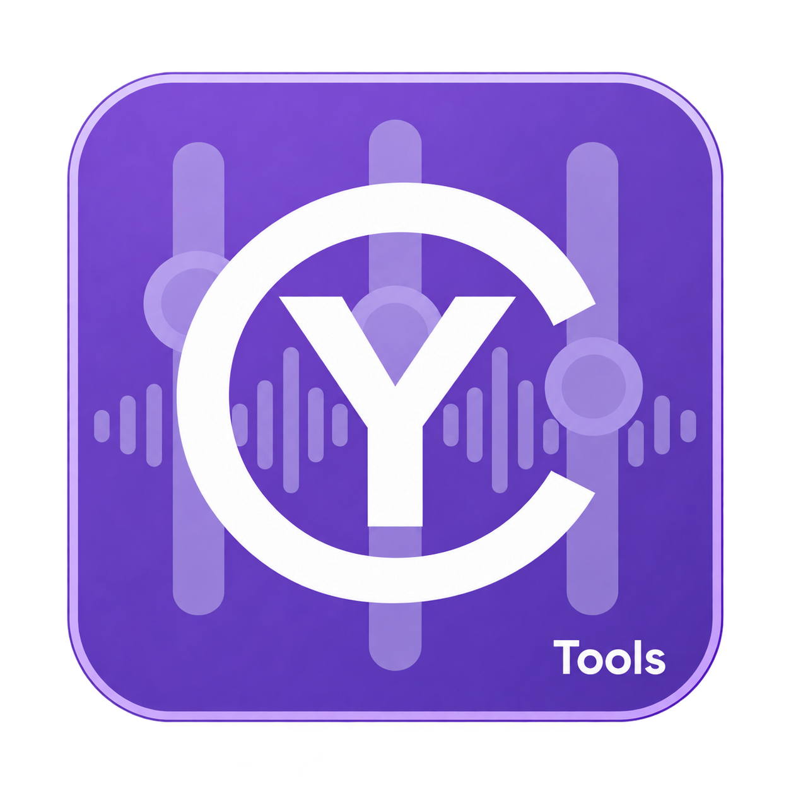
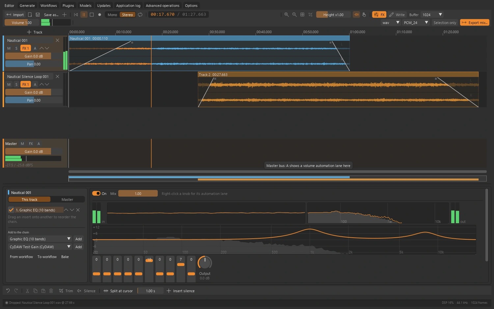
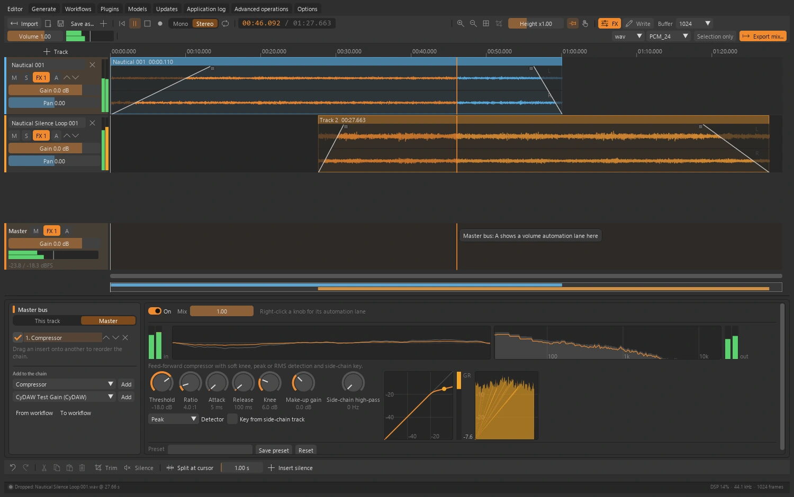
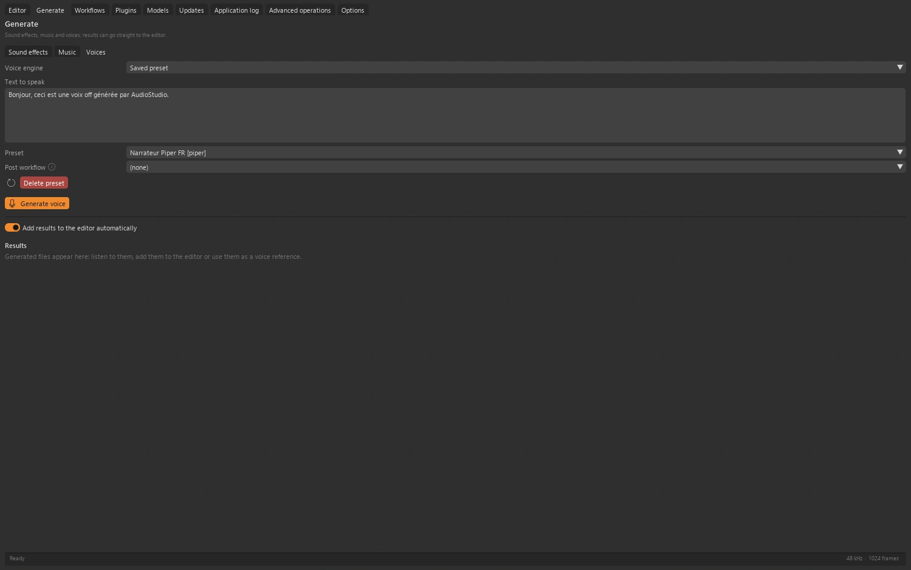

<table width="100%">
  <tr>
    <td width="300" align="left" valign="top">
      <a href="https://mrmybal.github.io/CyTools_AudioStudio/">Website</a><br>
      <a href="https://mrmybal.github.io/CyTools_AudioStudio/Documentation.html#/en/overview">Documentation</a><br>
      <a href="https://github.com/MrMybal/CyTools_AudioStudio">GitHub</a><br><br>
      <sub>README</sub><br>
      <a href="README.md">English</a> · <a href="README.fr.md">Français</a>
    </td>
    <td width="400" align="center" valign="middle">
      <a href="https://mrmybal.github.io/CyTools_AudioStudio/"></a>
    </td>
    <td width="300" align="right" valign="top">
      <p><sub>Application license</sub><br><a href="LICENSE"><strong>GPL-3.0-only</strong></a></p>
      <p><sub>Application version</sub><br><a href="VERSION.md"><strong>0.1.5</strong></a><br><strong>EXPERIMENTAL</strong></p>
      <p><a href="https://github.com/MrMybal/CyTools_AudioStudio/releases/download/v0.1.5/CyTools_AudioStudio-0.1.5-windows-x64.zip"><strong>Download</strong></a><br><sub>Windows x64 · portable</sub></p>
    </td>
  </tr>
</table>

<h1 align="center">CyTools AudioStudio</h1>


A multitrack workspace for audio editing, insert effects, reusable processing chains and optional sound, music and voice models. For sound designers, voice creators and editors who want hands-on audio tools alongside local generation.

> **EXPERIMENTAL · 0.1.5**
>
> Published Windows build for evaluation; some engine paths remain unvalidated. Read the [version notes and known limitations](VERSION.md).

[](website/assets/showcase/editor.webp)

*Multitrack editor · waveform clips and a track graphic EQ.*


## The application

### Multitrack editing

Move clips between tracks, trim their boundaries, shape fades and record from the microphone. Keep sessions as folders and use undo/redo while editing.

### Effects & monitoring

Native effects expose useful visual controls: EQ curves, dynamics transfer curves, meters, scopes and spectra. Work on a track or the master bus and compare the result as it plays.

[](website/assets/showcase/compressor.webp)

*Master compressor · transfer curve, gain reduction and meters.*


### Models & processing

Create sound effects, music or speech with a compatible installed backend. Keep model setup separate from the editor. Save processing workflows and apply them to selections, tracks, files or batches.

[](website/assets/showcase/generation.webp)

*Generation workspace · choose a family and configure the actual backend.*


## Features

- **Editing:** multitrack clips, trim/fades, selection editing, recording, track moves, sessions and undo/redo.
- **Processing:** native dynamics, EQ, filters, reverb, delay, modulation, saturation, restoration and analysers; track/master chains, live meters and automation.
- **Plugins and workflows:** compatible VST3 effects, saved processing chains, headless session editing and batch rendering. Reverb/delay tails are preserved.
- **Generation:** procedural effects and optional AudioLDM, ACE-Step, Piper, Qwen3-TTS and Fish Speech paths. Parameters and availability depend on the installed engine.
- **Mastering and voice presets:** loudness targets, reference mastering, reusable voice settings and compatible inline delivery annotations.

**Desktop and automation:** English is the default interface language; French is selectable in Options. Save/load generation configurations, follow copyable application logs and use the declared operations through the CLI or MCP. The [manual](https://mrmybal.github.io/CyTools_AudioStudio/Documentation.html#/en/overview) describes the real parameters and output contracts.

---

## Installation

The published application build is **Windows x64**. The portable ZIP includes its private Python runtime and base UI/media dependencies. Models and optional heavy engines are separate downloads.

1. [Download CyTools AudioStudio 0.1.5](https://github.com/MrMybal/CyTools_AudioStudio/releases/download/v0.1.5/CyTools_AudioStudio-0.1.5-windows-x64.zip).
2. Extract the complete ZIP into a writable folder. Keep `app/` and `runtime/` beside the launcher.
3. Open **CyTools_AudioStudio.exe**. Use the installation/model workspace for the components you need; review each component licence and any provider access conditions before download.

No machine Python is needed just to open the portable application. Source setup and some optional engine installers require additional tools such as Git. Keep the full release folder; the standalone `.exe` or an `app` update ZIP alone is not a complete installation.

Windows x64 is tested; Linux is unvalidated. Editing, native DSP, VST3 hosting and Piper use the CPU. Other generation backends have their own CUDA and memory requirements. Engines and weights are separate downloads. ASIO and VST2 are not provided.

### Updates and data

For an existing compatible installation, use its Updates page and the matching application update package. Keep `data/`, installed engines and models. An update for another runtime ABI must not be forced. If the required runtime changes, use the complete portable release in a separate folder and follow the migration instructions.

## Source, build and required libraries

<details>
<summary>Windows source setup and optional build tools</summary>


Use Python **3.11** for the base source environment. Git is needed for cloning and pinned Git requirements. Building the launcher needs the MSVC x64 Build Tools; use a developer command prompt.

```powershell
git clone https://github.com/MrMybal/CyTools_AudioStudio.git
cd CyTools_AudioStudio
py -3.11 -m venv runtime\python
runtime\python\Scripts\python.exe -m pip install "cytools-core[mcp] @ git+https://github.com/MrMybal/CyToolsCore.git@a8d200f2d0baaade1633e0683663b4506c595f74"
runtime\python\Scripts\python.exe -m pip install -r app\requirements.txt
runtime\python\Scripts\python.exe app\scripts\build_plugin_host.py
powershell -File app\build_launcher.ps1
.\CyTools_AudioStudio.exe
```

The exact base requirements are in [app/requirements.txt](app/requirements.txt). Engines use their own environments and model catalogues; installing the base environment does not install them. Follow the [developer setup](app/README.md) for the detailed build and optional components.

The isolated native plugin worker additionally needs CMake and a C++20 compiler; NASM is optional. Its separate licence and dependency choices are described in [app/native/README.md](app/native/README.md).

</details>

---

## License

**CyTools AudioStudio is licensed under [GPL-3.0-only](LICENSE).** CyToolsCore, CyUI and CyDoc remain MIT components; their licences do not change the application licence. Optional engines, plugins and model weights retain their own terms.

### Main components and third-party libraries

| Library · source | License · terms | Use / scope |
| --- | --- | --- |
| [CyToolsCore 0.10.1](https://github.com/MrMybal/CyToolsCore) | [MIT](LICENCES/CyToolsCore-MIT.txt) | SDK/runtime: jobs, sessions, resources, CLI and MCP. |
| [CyUI 1.2.0](https://github.com/MrMybal/CyUI) | [MIT](LICENCES/CyUI-MIT.txt) | Selected bundled Python UI modules. |
| [CyDoc 0.1.0](https://github.com/MrMybal/CyDoc) | [MIT](LICENCES/CyDoc-MIT.txt) | Bundled offline reader; Node/npm are authoring/build tools only. |
| [Dear ImGui / imgui-bundle](https://github.com/pthom/imgui_bundle) | [MIT + component notices](https://github.com/pthom/imgui_bundle/blob/main/LICENSE) | Desktop renderer and its bundled native components. |
| [CPython 3.11](https://www.python.org/) | [PSF + component notices](https://docs.python.org/3.11/license.html) | Private runtime included in the Windows portable archive. |
| [pedalboard](https://github.com/spotify/pedalboard) | [GPL-3.0](app/licenses.json) | Base native DSP and VST3 hosting; retains its JUCE notices. |
| [Isolated native plugin host / JUCE 8](app/native/README.md) | [AGPL-3.0; JUCE also offers commercial terms](app/native/licenses/JUCE-LICENSE.md) | Separate worker executable, not the GPL Python application. CMake/C++20 build; CLAP/ysfx dependencies keep their notices. |
| [NumPy / SciPy / PyAV / sounddevice](app/requirements.txt) | [BSD / MIT + native component notices](LICENCES/ThirdParty-Notices.txt) | Base processing, decoding, playback and recording. |
| [pyloudnorm / Matchering](app/requirements.txt) | [MIT / GPL-3.0](LICENCES/ThirdParty-Notices.txt) | Loudness measurement and reference mastering. |
| [Piper / ONNX Runtime](app/requirements-engine-piper.txt) | [GPL-3.0-or-later / MIT](https://github.com/OHF-Voice/piper1-gpl/blob/main/COPYING) | Optional CPU voice engine; voice weights retain their own licences. |
| [PyTorch and generation engines](app/engines.json) | [Component-specific; separate model terms](app/licenses.json) | Optional AudioLDM, ACE-Step, Qwen3-TTS and Fish Speech engines. Fish Speech weights have research restrictions. |

This table indexes the main components; it does not replace their complete transitive notices. Retain [LICENCES/](LICENCES/), [app/licenses.json](app/licenses.json), the licences beside installed packages and the notices in each optional engine/model. CUDA libraries, when installed, also retain NVIDIA’s terms.

The Python application is GPL-3.0-only. The isolated native worker is a separate AGPL-3.0 executable; retain its [JUCE licence](app/native/licenses/JUCE-LICENSE.md) and bundled dependency notices. Piper 1.8.0 uses GPL-3.0-or-later; ONNX Runtime and individual voices have separate terms.

## References and links

- [Documentation](https://mrmybal.github.io/CyTools_AudioStudio/Documentation.html#/en/overview)
- [Website](https://mrmybal.github.io/CyTools_AudioStudio/)
- [Source repository](https://github.com/MrMybal/CyTools_AudioStudio) · [Releases and checksums](https://github.com/MrMybal/CyTools_AudioStudio/releases)
- [Issue tracker](https://github.com/MrMybal/CyTools_AudioStudio/issues) · [Version notes](VERSION.md)
- [Developer setup](app/README.md)

<details>
<summary><strong>AI Usage</strong></summary>

- [Start here: project agent guide](app/AGENTS.md) — product rules and important files.
- [Operations and AI integration](app/Documentation/DocAI.md) — actual tool contracts and task usage.
- [Build this application](app/README.md) — source setup and application-specific commands.

</details>
